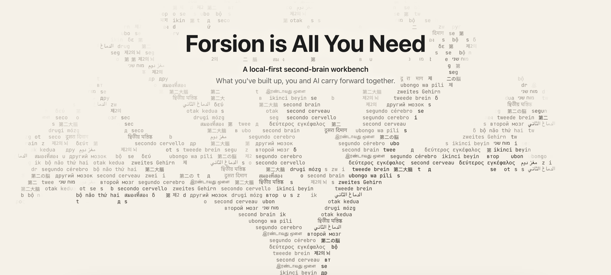
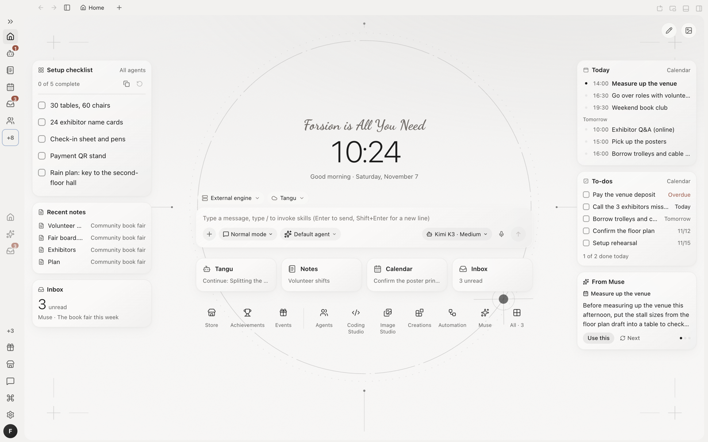
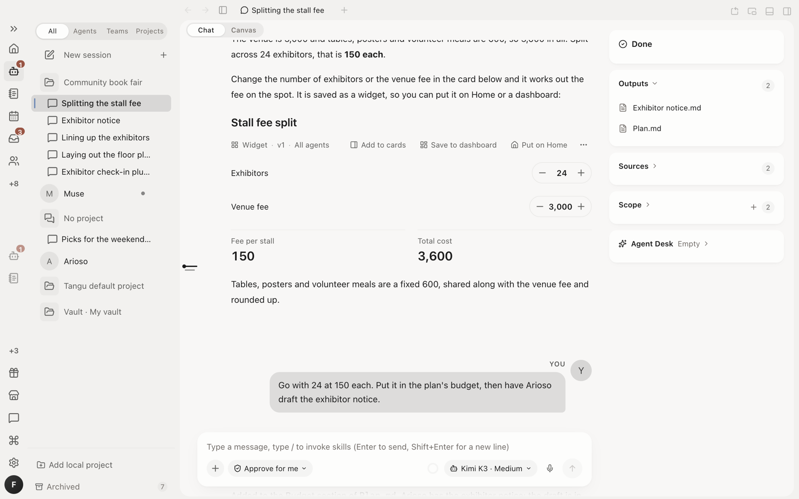
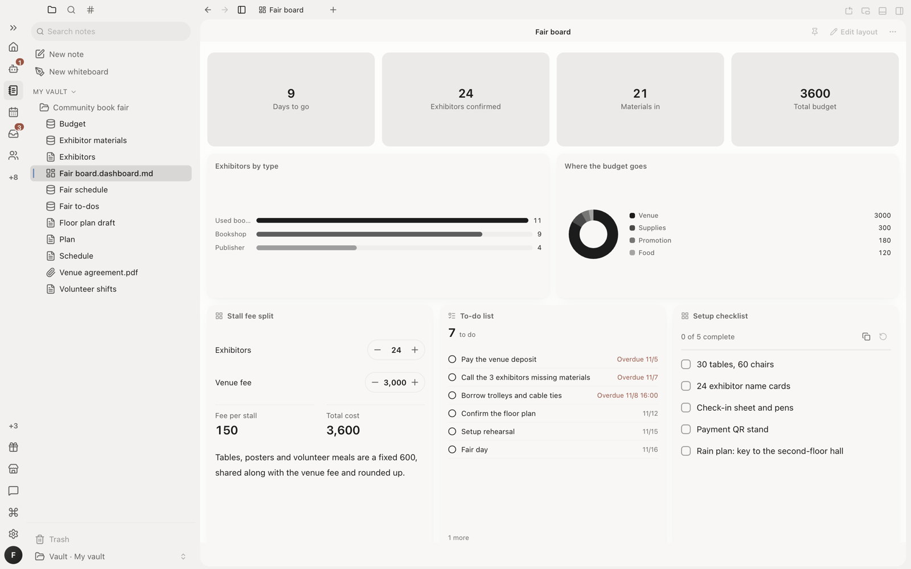
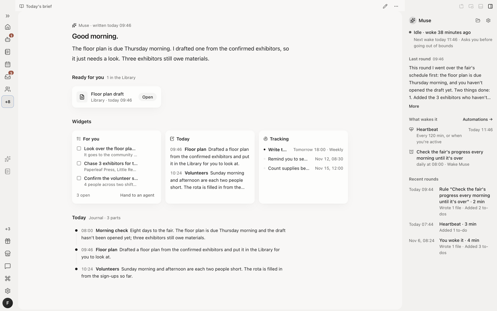
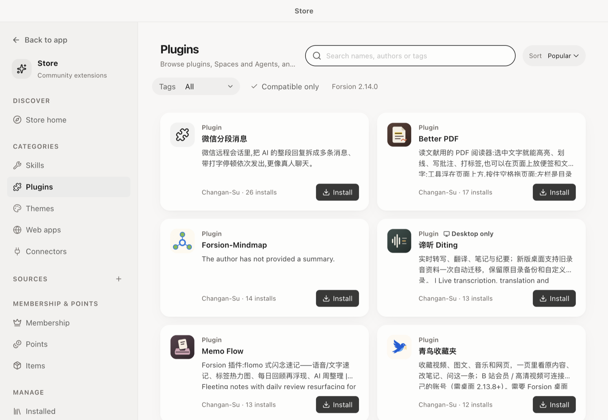
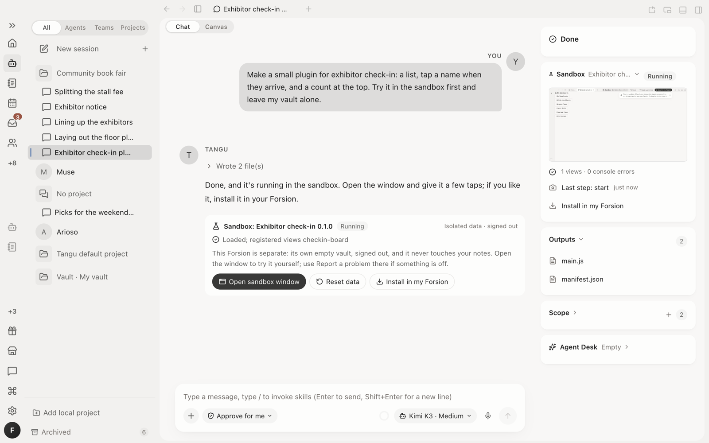
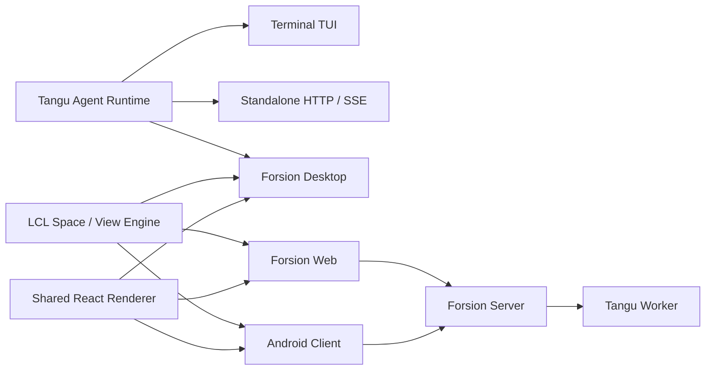

<div align="center">

<picture>
  <source media="(prefers-color-scheme: dark)" srcset="./.github/assets/showcase/hero-en-dark.png">
  
</picture>

**English** · [简体中文](./README.zh-CN.md)

[](https://github.com/Changan-Su/Forsion/releases)

[](./LICENSE)

[Download](https://github.com/Changan-Su/Forsion/releases/latest) · [Web app](https://ai.forsion.net) · [Quick start](./docs/getting-started/quickstart.en.md) · [Docs](./docs/README.en.md) · [Website](https://forsion.net)

</div>

**Forsion is a local-first second-brain workbench.** Your notes, files and projects sit on one desk on your own computer, and AI works on that desk with you. Ask in a chat: Tangu, the agent built into Forsion, reads your files before it answers, the answer comes back as something you can keep using, and what you work out stays in plain files you can open anywhere.

| On the desk | What it means |
| --- | --- |
| **Your files** | Notes are Markdown on disk, next to PDFs, whiteboards, databases and calendars. Forsion opens them where they are. |
| **Answers you can use** | An answer can carry a card that works things out. Keep it as a widget on Home or a dashboard. |
| **An agent that speaks first** | Muse watches your schedule and rules, gets things ready, and messages you when something needs you. |
| **Completing each other** | You write `AGENT.md` for agents; they write `HUMAN.md` for you. What you agree on stays in files you can read. |
| **Your own tools** | Over twenty official plugins in the store. Missing one? Ask Tangu to build it and try it in a sandbox first. |

Say you're running a neighborhood book fair. The screenshots below follow it through the real Forsion interface with sample data; they are not a live model run. [How they were captured](./.github/assets/showcase/README.md).

## Home is your desk

Home lays out your widgets on both sides: today's schedule, your to-dos, a suggestion from Muse, your recent notes, and the setup checklist you made in a chat. The plan, the venue agreement and the exhibitor list are plain files on your computer, and Forsion opens them where they are.

<p align="center">
  
</p>

- **Write in blocks, keep Markdown.** A Notion-style block editor on local `.md` files: slash commands, columns, callouts, `[[wikilinks]]`, backlinks and a graph.
- **More than notes.** Databases with table, board, calendar and gallery views; Excalidraw-compatible whiteboards; PDF annotations saved into the PDF itself; a calendar that gathers dates and to-dos.
- **Arrange it your way.** Spaces, split panels, tabs you can drag out into their own windows, and a Mini panel that can stay on top of other apps.

[Block editor (中文)](./docs/amadeus/editor.md) · [Databases (中文)](./docs/amadeus/databases.md) · [Whiteboards (中文)](./docs/amadeus/whiteboard.md) · [Workspace (中文)](./docs/getting-started/workspace.md)

## Ask, and the answer stays useful

Hand the plan and the agreement to Tangu and ask what the stall fee should be. It reads both files before it answers. The answer comes with a card that works things out: change the number of exhibitors or the venue fee and it recalculates on the spot, without asking the model again. Keep it as a widget, and it sits on Home or a dashboard.

<p align="center">
  
</p>

The book fair dashboard holds that card, your to-dos and the setup checklist. The exhibitors and the budget live in two tables, and the numbers and charts are worked out straight from them.

<p align="center">
  
</p>

- **Tangu works on your files.** Within the access you grant, it reads sources, compares options and writes conclusions back to the project. Every turn lists the files it changed, and you can undo one file or the whole turn.
- **More than one agent.** Arioso, Aria, Recita and Coding each have their own personality, memory and model. Pick two or more to work as a team, each in its own thread, with Team Desk showing who is doing what.
- **Any model.** Forsion-hosted models, your own API keys, OpenAI-compatible endpoints, local Ollama, or a supported subscription login. Installed Claude Code and Codex can join through ACP and work in your project folder; their memory and approvals stay their own.

[Chat basics (中文)](./docs/chat/basics.md) · [Dashboards (中文)](./docs/amadeus/dashboard.md) · [TEAM and Team Desk](./docs/chat/group-chat.en.md) · [Models (中文)](./docs/chat/models-and-providers.md)

## Muse speaks first

Most AI waits for you to say something. Muse, the proactive agent, keeps an eye on your schedule and the rules you set. With the floor plan nearly due, it drafts one from the confirmed exhibitors and messages you right away. The week's progress can wait, so it comes as a letter in your Inbox: what's done, what's left, and what it already got ready for you.

<p align="center">
  
</p>

- **Its own Space.** Today's briefing puts what needs you, what it got ready and what it is following on one page, along with when it wakes next.
- **Ordinary files.** What it prepares is notes and calendar entries you can open, edit or delete.
- **Your limits.** You set active hours, budgets and approval levels. Muse works while Forsion is running on your computer, and agents can reach you through the WeChat, Telegram or QQ channels you set up.

[Proactive Muse (中文)](./docs/agents/muse.md) · [Inbox (中文)](./docs/spaces/inbox.md) · [Automation](./docs/spaces/automation.en.md) · [Channels (中文)](./docs/chat/channels.md)

## The Human Completion Plan

Not overwriting each other, but completing each other. People and AI keep their own boundaries, fill in what the other lacks, and keep the ways they have learned to work together, in files on both sides.

| File | Yours, in `human/` | An agent's, in `agents/arioso/` |
| --- | --- | --- |
| `AGENT.md` | You write it, for every agent | You write it, just for this one *(planned)* |
| `HUMAN.md` | Agents write it: what you've agreed on | It writes it: how working with it goes better |
| `SOUL.md` | You, as agents see you | You write it: who it is |
| `MEMORY.md` | You keep it | It keeps it |

`AGENT.md` is always people writing to agents. `HUMAN.md` is always agents writing to people. Whose folder a file sits in tells you whose side it's on.

- **Memory you can see.** Tell an agent something once and it remembers. Read, edit or forget any memory in the memory panel; forgetting keeps the revision history.
- **Bring what other AIs know.** Import memories, preferences and skills that Claude Code, Codex or Gemini CLI have kept, as a review list. Only what you tick is written, and the whole import can be undone.

[Memory (中文)](./docs/agents/memory.md) · [Agents (中文)](./docs/agents/overview.md)

## Missing something? Get it from the store

The store has PDF annotation, mind maps, live transcription, Jupyter notebooks, flashcards and more, with over twenty official plugins so far. Ask in a chat and Tangu finds the plugin for you; install it with a click. You can also add your own sources: a GitHub repository, an npm package or a URL.

<p align="center">
  
</p>

- **Forsion Clip.** A Chrome and Edge extension that comes with Forsion Desktop. Save a web page into the vault Forsion has open and ask Tangu about it on the side; once paired, Tangu can also operate the browser for you.

[Plugins](./docs/customization/plugins.en.md) · [Store (中文)](./docs/customization/market.md) · [Skills (中文)](./docs/agents/skills.md)

## Build on it

A plugin is a folder. One folder can bring an interface, tools for agents, an agent of its own and a Space, all installed together. Forsion's own calendar is a plugin.

- **Three layers.** A Space is a room laid out for one kind of work. A View is a panel you can open on its own, in the main area, the sidebar or a floating window. UI components are the parts inside a View: the chat box, tables, menus. Plugins hook into the same three layers.
- **Ready-made parts.** The parts Forsion uses itself, such as the chat box, settings page, table, Markdown editor, whiteboard layer and record card, are open to plugins and look the same as in the app.
- **No code needed.** Tell Tangu what you want. It writes the plugin and runs it in a sandbox first: a separate Forsion with an empty vault, signed out, away from your notes. Install it once you're happy.
- **Share it.** Submit it to the store. Once approved, anyone can install it from the store or from a chat.
- **The runtime underneath.** Tangu also runs as a terminal UI or a headless HTTP / SSE service, and Forsion hosts other agents through ACP.

<p align="center">
  
</p>

[Plugin development](./docs/customization/plugin-development.en.md) · [UI components](./docs/customization/ui-components.en.md) · [Themes](./docs/customization/themes.en.md) · [External engines (中文)](./docs/agents/external-engines.md)

## Download and start

Download the latest release from [GitHub Releases](https://github.com/Changan-Su/Forsion/releases/latest), or open the [web app](https://ai.forsion.net) in a browser.

| Platform | Release artifact | Notes |
| --- | --- | --- |
| macOS | `Forsion-*-arm64.dmg` | Apple silicon. |
| Windows | `Forsion-*-x64.exe` | NSIS installer. |
| Linux | `Forsion-*-x86_64.AppImage` | Add execute permission, then run. |
| Android | `Forsion-Tangu-*-android.apk` | Connects to your Forsion account; fewer features than Desktop. |
| Web | [ai.forsion.net](https://ai.forsion.net) | Use this on iPhone and iPad. |

Every desktop release includes two distributions. `Forsion-<version>-<arch>` bundles Forsion Extend for account and cloud features. `Forsion-NoExtend-<version>-<arch>` includes the local app and Agent backend without bundling Extend; cloud account, sync, publishing and remote device features require Extend. Both use the same app identity and data folders. Windows/Linux updates stay within the chosen distribution; on macOS, download the same filename variant when updating.

For local builds, run `FORSION_BUNDLE_EXTEND=0 npm run build`, then `FORSION_BUNDLE_EXTEND=0 npm run dist` from `desktop/`. Omitting the variable produces the default distribution.

1. **Install and connect a model.** First launch helps configure your connection, model and workspace. The desktop installer includes the Agent backend and Node.js runtime.
2. **Put a real project on the desk.** Create a project note with a goal, sources and next steps. Ask Tangu to read it, and tell it one preference worth remembering.
3. **Finish one useful task.** Ask for something you need from that material, open the saved file, and check the preference in the memory panel. Add Muse, teams and plugins when you need them.

The [quick start](./docs/getting-started/quickstart.en.md) walks through this path.

> **Installer signing:** macOS builds use ad-hoc signing and are not yet notarized; Windows builds may trigger SmartScreen. Download from this repository's Releases. If Gatekeeper blocks the first open on macOS, right-click the app and choose “Open”, or allow it in **System Settings → Privacy & Security**.

## Where Your Data Lives

The official desktop build uses, by default:

| Path | Contents |
| --- | --- |
| `~/.forsion/` | Account, settings, Agent data, sessions, skills, plugins and local databases. |
| `~/Forsion/` | User-visible workspace, knowledge base and project files. |

The dev build uses separate `~/.forsion-dev/` and `~/Forsion-Dev/` so it won't pollute production data. Legacy `~/.tangu` / `~/Tangu` data is migrated by the desktop app, which keeps a compatibility entry point.

Back up these two directories regularly, just like ordinary documents. Before running high-privilege Agent tasks, confirm the approval tier and the current working directory.

## Build from source

**Forsion Genesis** is the source repository for the product family: the Tangu Agent runtime, the LCL Space / View / Plugin engine, Desktop, Web, Android, and product profiles such as Amadeus.

See [web/README.md](./web/README.md) for Web deployment and [mobile/README.md](./mobile/README.md) for Android builds. Expand below for all development commands and the architecture.

<details>
<summary>Development, deployment, and architecture</summary>

## Local Development

### Requirements

- Node.js 20 or newer;
- npm and Git;
- The native build toolchain for your target platform when building installers;
- JDK 17 and the Android SDK additionally for Android builds;
- Docker only when using the Python sandbox or container deployment.

### Run the Desktop App in Dev

```bash
git clone https://github.com/Changan-Su/Forsion.git
cd Forsion

# Build the Agent backend embedded in the desktop app first
cd tangu-agent
npm ci
npm run build

# Then start the Electron desktop app
cd ../desktop
npm ci
npm run dev
```

The `desktop` `postinstall` automatically sets up the LCL dependency links. Keep the existing directory relationships from the repository root — do not copy `desktop/` or `lcl/` on their own.

Common commands:

| Directory | Command | Purpose |
| --- | --- | --- |
| `tangu-agent/` | `npm run build` | Compile the Agent runtime. |
| `tangu-agent/` | `npm run typecheck` | Check types and plugin-API sync status. |
| `tangu-agent/` | `npm test` | Run the runtime tests. |
| `tangu-agent/` | `npm run build && npm run smoke:tooldefs` | Reproduce missing tool definitions and verify isolation before model requests. |
| `tangu-agent/` | `TANGU_PLUGINS_DIR="$PWD/test/fixtures" npm run live:harness -- --only chat,tool` | Verify chat and file tools with an invalid plugin loaded, using the dev model credentials. |
| `desktop/` | `npm run dev` | Start the desktop dev environment. |
| `desktop/` | `npm run typecheck` | Check desktop types. |
| `desktop/` | `npm test` | Run desktop unit tests. |
| `desktop/` | `npm run build` | Build the Electron main process, preload and renderer. |
| `desktop/` | `npm run dist` | Produce an installer for the current platform. |
| `desktop/` | `node scripts/dmg-layout-preview.cjs` | macOS only. Build a tiny DMG around an empty app shell to check the installer window (background, icon positions) in Finder without a full build. |
| `desktop/` | `npm run e2e:editor` | Run the Amadeus editor end-to-end tests. |
| `desktop/` | `npm run check:toggle` / `npm run check:toggleenter:electron` | Regress toggle ownership after two Enter presses; build first for the Electron check, which also verifies disk persistence and app restart. |

If an Electron harness hangs at launch with no output and no renderer process, run `sample <electron-pid> 1`. A main thread stuck in `NSAlert runModal` under `promptToIgnorePersistentStateWithCrashHistory:` is macOS asking to reopen windows after the shared dev `Electron.app` crashed. Playwright-launched instances skip that prompt: `electron/main.ts` registers `ApplePersistenceIgnoreState` in memory only. Harnesses spawned without Playwright must set `TANGU_HARNESS_QUIET=1`. `npm run check:persistignore` (add `-- --control` for the negative control) verifies that AppKit reads the key.

### Run the TUI or Headless Service

```bash
cd tangu-agent
npm ci
npm run build

# Optional: copy and edit local config
mkdir -p ~/.tangu
cp example.env ~/.tangu/.env

npm run tui       # Terminal interface
npm run server    # HTTP / SSE service, default 127.0.0.1:8787
```

`example.env` shows how to configure local models, OpenAI-compatible providers, Forsion Cloud, databases, the sandbox and the worker. Never commit real tokens or API keys to the repository.

### Build Other Product Profiles

The default profile is Forsion, with all six Spaces. The repository also provides an Amadeus profile that does not bundle the Agent backend or the store:

```bash
cd desktop
npm run dev:amadeus
npm run build:amadeus
npm run pack:amadeus
```

When adding a new product, define its product identity, default Spaces, feature set and backend capabilities in `desktop/products/`, and add profile tests.

## Web & Deployment

### Web Local Development

Forsion Web reuses the desktop rendering layer and connects to a running Forsion Server. The default dev address is `http://localhost:5273`, with the backend proxy target at `http://localhost:3001`.

```bash
cd web
cp .env.example .env
npm ci
npm run dev
```

### Web Container Deployment

The Docker build context must be the repository root, because Web reads source from `desktop/frontend`, `desktop/shared` and `lcl`.

```bash
BACKEND_URL=http://host.docker.internal:3001 \
  docker compose -f web/docker-compose.yml up -d --build
```

The site is published to host port `8090` by default. See [web/README.md](./web/README.md) for full reverse-proxy, environment-variable, HTTPS and troubleshooting notes.

### Android

The mobile client is primarily Android / Capacitor, reusing the desktop rendering layer with a single-column interface. It is currently better suited for development and validating mobile workflows than as a full replacement for the desktop app. See [mobile/README.md](./mobile/README.md) for build steps and deep-link login requirements.

## Architecture



The Tangu Agent isolates storage, models, billing and runtime environment through the `host`, `brain`, `billing` and `profile` seams; LCL splits interface capabilities into registrable Spaces and Views. Combined, the same business capability can be reused across the local desktop, self-hosted services and cloud-connected clients.

### Repository Structure

```text
Forsion/
├── tangu-agent/   # Agent runtime, TUI, standalone, tools, skills & plugin API
├── lcl/           # Space / View / Plugin workspace engine
├── desktop/       # Electron main process, shared React renderer & product profiles
├── web/           # Vite + nginx browser client
├── mobile/        # Capacitor Android client
├── unit/          # Standalone Forsion Unit framework & local plugins
├── docs/          # User documentation
├── scripts/       # Open-source boundary check
├── .github/       # CI workflows
├── archived/      # Read-only historical implementations
└── Dockerfile.standalone  # Worker image used by Tangu Manager
```

### Client Status

| Form | Role | Status |
| --- | --- | --- |
| Desktop | The full Forsion workbench for everyday use | Primary release target |
| TUI / Standalone | Terminal use, scripting integration and local service | Available, maintained alongside the runtime |
| Web | A standalone web client connected to Forsion Server | Self-hostable, depends on the server |
| Mobile | Android cloud connection and mobile workflows | Under active development |

## Testing & Release

Before committing, at least run the type checks and tests relevant to your changes:

```bash
cd tangu-agent
npm run typecheck
npm test

cd ../desktop
npm run typecheck
npm test
```

The release workflow is triggered by `v*` tags: it first checks Tangu Agent types and tests, then builds installers on macOS, Windows and Linux runners respectively, and finally creates or updates the GitHub Release. You can also run the build manually from the Actions page and download the Artifacts.

User-visible desktop changes should be recorded in [desktop/CHANGELOG.md](./desktop/CHANGELOG.md).

</details>

## Contributing

Issues and Pull Requests are welcome. To make problems easier to reproduce and merge:

1. When filing a bug, include the Forsion version, operating system, reproduction steps, expected behavior and any necessary logs;
2. Search existing issues before development, and keep each Pull Request focused on one clear problem;
3. Do not commit `.env`, tokens, local databases, workspace content or build artifacts;
4. Behavior changes need added or updated tests, and user-visible changes need a Changelog update;
5. When modifying the shared rendering layer, consider the capability differences and runtime gating across Desktop, Web and Mobile.

You can view or file issues from [Issues](https://github.com/Changan-Su/Forsion/issues), or open a Pull Request directly to help improve the project.

## License

Forsion Genesis uses the [Modified Apache License 2.0](./LICENSE). It is based on Apache License 2.0 with additional conditions, mainly covering:

- You may not use this repository's code to operate a multi-tenant environment without written authorization;
- When using the `desktop/`, `web/` or `mobile/` frontends, you may not remove or modify the logo, product name and copyright notices in the interface;
- Commercial use is permitted when the additional conditions are met; a commercial license should be obtained for multi-tenant deployment or other authorizations.

Please read the full license text before using, distributing or offering services based on this project. This license includes restrictions beyond Apache-2.0, so it should not be understood as the standard Apache-2.0 license alone.
