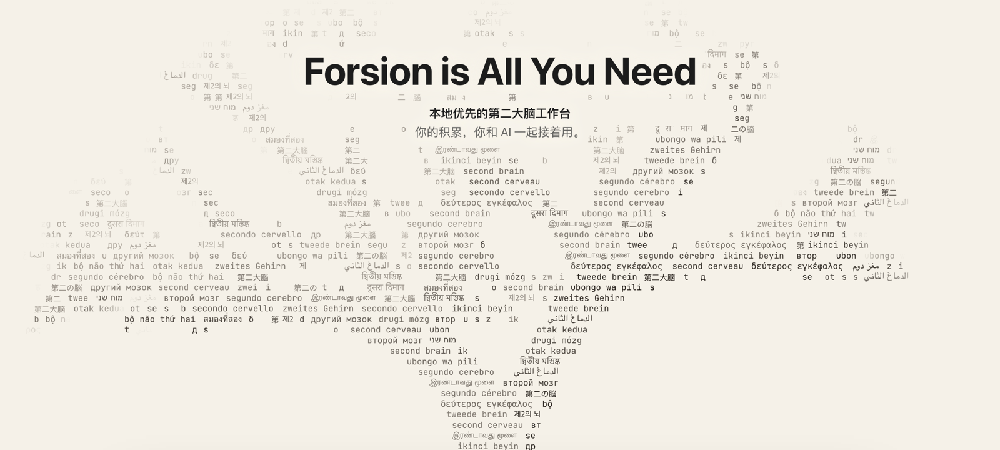
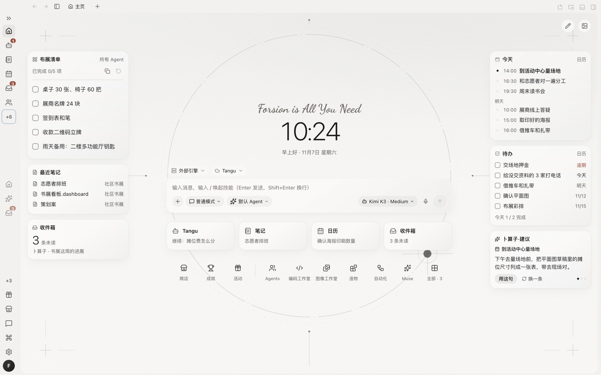
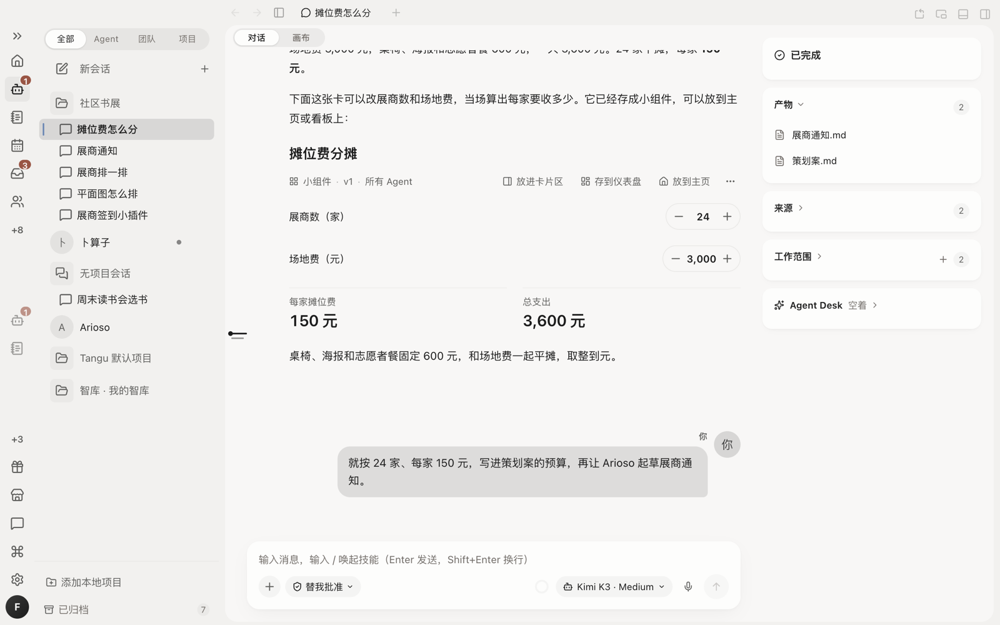
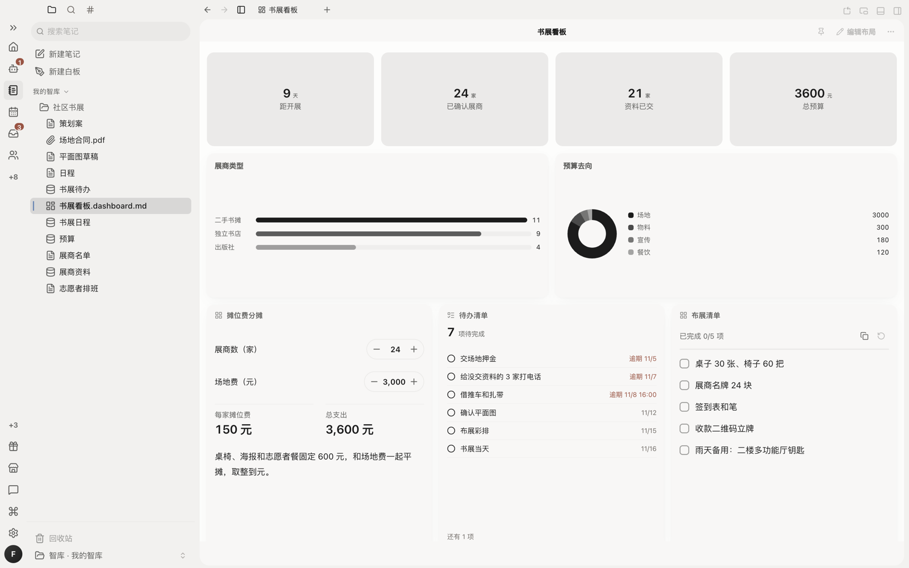
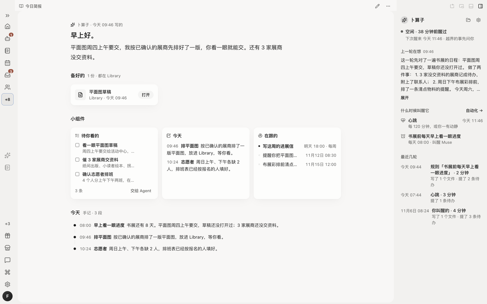
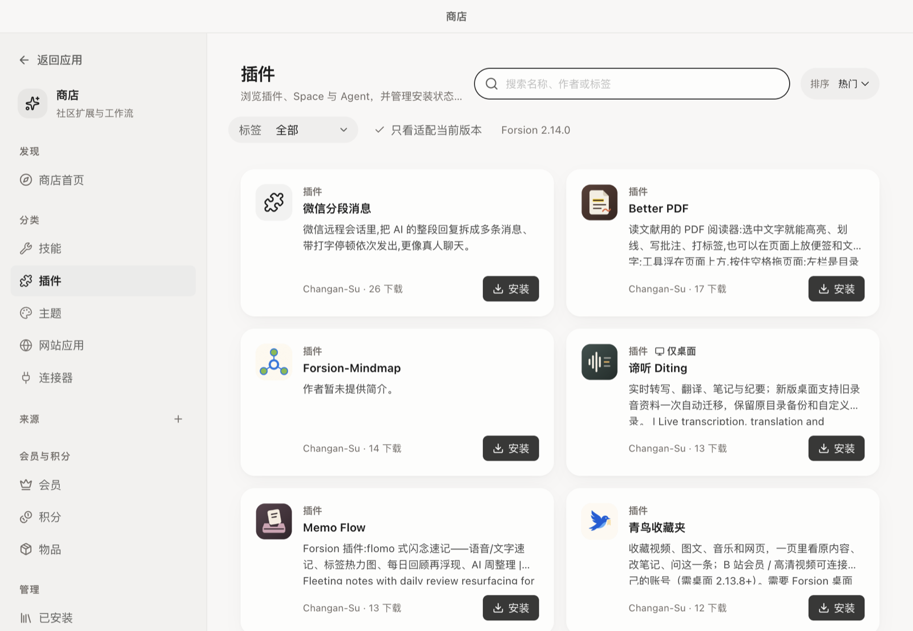
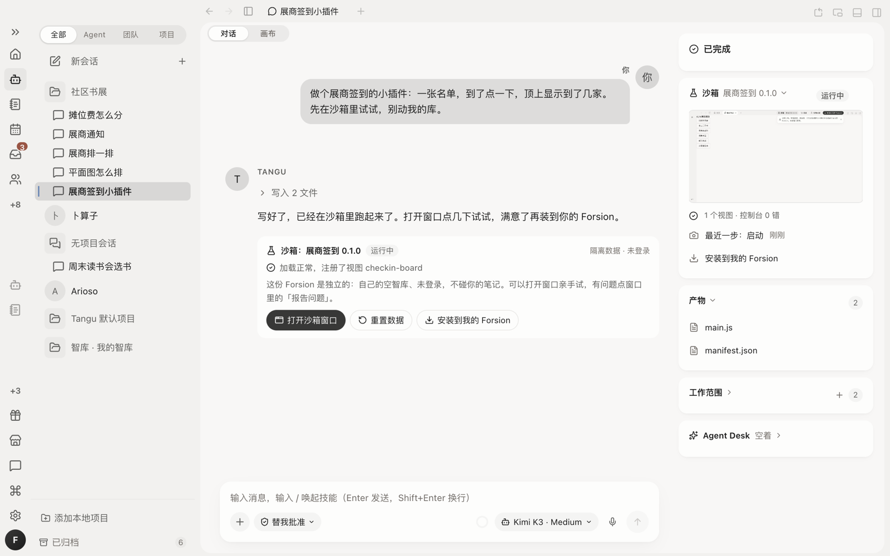
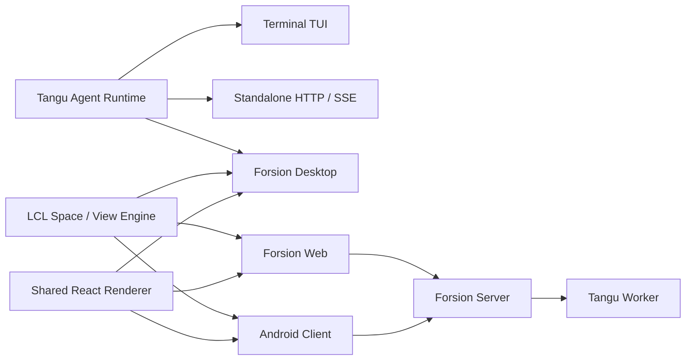

<div align="center">

<picture>
  <source media="(prefers-color-scheme: dark)" srcset="./.github/assets/showcase/hero-zh-dark.png">
  
</picture>

[English](./README.md) · **简体中文**

[](https://github.com/Changan-Su/Forsion/releases)

[](./LICENSE)

[立即下载](https://github.com/Changan-Su/Forsion/releases/latest) · [网页版](https://ai.forsion.net) · [快速上手](./docs/getting-started/quickstart.md) · [使用文档](./docs/README.md) · [官方网站](https://forsion.net/zh/)

</div>

**Forsion（扶桑）是本地优先的第二大脑工作台。** 笔记、文件和项目放在你自己电脑上的一张台面上，AI 在这张台面上和你一起干活。在对话里问一句：Tangu（Forsion 自带的 Agent）先读你的文件再回答，回答是能接着用的东西，磨合出的办法留在普通文件里，别的软件也打得开。

| 台面上有 | 也就是说 |
| --- | --- |
| **你的文件** | 笔记是本地 Markdown，和 PDF、白板、多维表、日历放在一起。Forsion 直接打开它们。 |
| **能接着用的回答** | 回答里可以带一张能算的卡，存成小组件，放到主页或仪表盘上。 |
| **先开口的 Agent** | 卜算子盯着你的日程和规则，先把东西备好，有事要你定才来找你。 |
| **相互补全** | `AGENT.md` 你写给 Agent，`HUMAN.md` Agent 写给你。说定的事留在打得开的文件里。 |
| **你自己的工具** | 商店里有二十多个官方插件。缺一个，就让 Tangu 做，先在沙箱里试。 |

比如你在筹办一场社区书展。下面的截图跟着它走一遍，是 Forsion 的真实界面和样例数据，不代表一次真实模型执行。[截图来源与复现](./.github/assets/showcase/README.md)。

## 主页是你的台面

主页两边摆着小组件：今天的日程、待办、卜算子的建议、最近的笔记，还有在对话里做出来的布展清单。策划案、场地合同、展商名单都是你电脑上的普通文件，Forsion 直接打开它们。

<p align="center">
  
</p>

- **块编辑，还是 Markdown。** 本地 `.md` 文件上的 Notion 式块编辑：斜杠菜单、分栏、标注块、`[[双链]]`、反向链接和关系图。
- **不只是笔记。** 多维表有表格、看板、日历、画廊视图；白板兼容 Excalidraw；PDF 批注写回 PDF 本身；日历把各处的日期和待办汇到一起。
- **按你的习惯摆。** Space、分栏、能拖成独立窗口的标签页，还有能置顶在其他应用上面的 Mini 面板。

[块编辑器](./docs/amadeus/editor.md) · [多维表](./docs/amadeus/databases.md) · [白板](./docs/amadeus/whiteboard.md) · [工作区](./docs/getting-started/workspace.md)

## 问一句，回答能接着用

把策划案和合同交给 Tangu，问摊位费该收多少。它读完两份文件再回答。回答里带一张能算的卡：改展商数或场地费，当场算出每家多少钱，不用再问一次模型。存成小组件，主页和仪表盘上都能放。

<p align="center">
  
</p>

书展的仪表盘上摆着这张卡、待办和布展清单。展商和预算记在两张表里，上面的数字和图表直接从表里算出来。

<p align="center">
  
</p>

- **Tangu 在你的文件上干活。** 在你授权的范围内读资料、比方案，把结论写回项目。每一轮改了哪些文件都有回执，可以撤销单个文件，也可以撤销整轮。
- **不止一位 Agent。** 行香子、浣溪沙、临江仙和 Coding 各有各的性格、记忆和模型。选两位以上就能组队，各开一条子对话，Team Desk 上看得到谁在做什么。
- **模型随你。** Forsion 托管的模型、自己的 API Key、OpenAI 兼容接口、本地 Ollama，或支持的订阅登录都行。装好的 Claude Code、Codex 也能经 ACP 接进来，在你的项目文件夹里干活；它们的记忆和审批仍是各自的。

[对话基础](./docs/chat/basics.md) · [仪表盘](./docs/amadeus/dashboard.md) · [TEAM 与 Team Desk](./docs/chat/group-chat.md) · [模型与服务商](./docs/chat/models-and-providers.md)

## 卜算子先开口

大多数 AI 等你开口。主动式 Agent 卜算子盯着你的日程和你定的规则：平面图快到期了，它按已确认的展商先排好一版，马上发消息告诉你。一周的进展不着急，就写成一封信放进收件箱：做完了什么、还差什么、它已经替你备好了什么。

<p align="center">
  
</p>

- **它自己的 Space。** 「今日简报」把要你看的、它备好的、在跟的事摆在一页上，还写着它下次什么时候醒。
- **备好的就是普通文件。** 笔记和日程，打开、改、删都随你。
- **界限你定。** 运行时段、预算和审批档都由你设。卜算子在你电脑上的 Forsion 运行时工作；Agent 也能通过你配好的微信、Telegram、QQ 通道找到你。

[主动式卜算子](./docs/agents/muse.md) · [收件箱](./docs/spaces/inbox.md) · [自动化](./docs/spaces/automation.md) · [通道](./docs/chat/channels.md)

## 人类补完计划

不是覆盖，是相互补全。人和 AI 保留各自的边界，把彼此缺的能力接起来，把合作的方法留下来，两边都写在文件里。

| 文件 | 你的，在 `human/` | Agent 的，在 `agents/arioso/` |
| --- | --- | --- |
| `AGENT.md` | 你写，给所有 Agent | 你写，只给它（计划中） |
| `HUMAN.md` | Agent 们写：和你的共识 | 它写：跟它合作怎样更顺 |
| `SOUL.md` | Agent 们眼里的你 | 你写：它的样子 |
| `MEMORY.md` | 你自己记 | 它自己记 |

`AGENT.md` 永远是人写给 Agent 的，`HUMAN.md` 永远是 Agent 写给人的。放在谁的文件夹里，就是谁那一边。

- **记忆看得见。** 说过一次就记得。在记忆面板里看、改，或者让它忘；忘掉的仍留着修订历史。
- **把别的 AI 记下的带过来。** Claude Code、Codex、Gemini CLI 等记下的记忆、偏好和技能，整理成一张审阅单，勾过的才写入，整次导入可以撤销。

[记忆](./docs/agents/memory.md) · [Agent](./docs/agents/overview.md)

## 缺什么，去商店

商店里有 PDF 批注、思维导图、实时转写、Jupyter、闪卡……官方插件已经有二十多个。在对话里说一句，Tangu 帮你去商店找，点一下就装。也可以添加自己的来源：GitHub 仓库、npm 包或网址。

<p align="center">
  
</p>

- **Forsion Clip。** Chrome 和 Edge 的浏览器扩展，随 Forsion 桌面版附带。把网页存进 Forsion 正打开的智库，旁边就能问 Tangu；配对之后，Tangu 还能替你操作浏览器。

[插件](./docs/customization/plugins.md) · [商店](./docs/customization/market.md) · [技能](./docs/agents/skills.md)

## 在它上面造东西

一个文件夹就是一个插件，能带来界面、给 Agent 用的工具、一位 Agent 和一个 Space，装上一起到位。Forsion 自己的日历就是一个插件。

- **三层。** Space 是一间房，管里面摆什么、摆在哪；View 是能单独打开的一块，放主区、侧栏或浮窗都行；UI 组件是 View 里的零件，输入框、表格、菜单这些。插件接在同样的三层上。
- **现成的零件。** Forsion 自己用的零件，Chat Box、设置页、表格、Markdown 编辑器、白板层、记录卡等，插件挂上就能用，样子和应用里的一样。
- **不写代码也行。** 把想要的说给 Tangu，它把插件写出来，先在沙箱里跑给你试：一份单独的 Forsion，空库、没登录，不碰你的笔记。满意了再装。
- **发到商店。** 投稿，审核通过就上架。别人在商店里或对话里，点一下就能装。
- **底下的运行时。** Tangu 也能跑成终端界面或无头 HTTP / SSE 服务；Forsion 是 ACP 宿主，别的 Agent 能在同一个项目里干活。

<p align="center">
  
</p>

[插件开发](./docs/customization/plugin-development.md) · [UI 组件](./docs/customization/ui-components.md) · [主题](./docs/customization/themes.md) · [外部引擎](./docs/agents/external-engines.md)

## 下载与开始使用

从 [GitHub Releases](https://github.com/Changan-Su/Forsion/releases/latest) 下载最新版本，或者直接在浏览器里打开[网页版](https://ai.forsion.net)。

| 平台 | 发布产物 | 说明 |
| --- | --- | --- |
| macOS | `Forsion-*-arm64.dmg` | Apple 芯片。 |
| Windows | `Forsion-*-x64.exe` | NSIS 安装程序。 |
| Linux | `Forsion-*-x86_64.AppImage` | 添加执行权限后运行。 |
| Android | `Forsion-Tangu-*-android.apk` | 连你的 Forsion 账号使用，功能比桌面版少。 |
| 网页版 | [ai.forsion.net](https://ai.forsion.net) | iPhone 和 iPad 先用网页版。 |

每次桌面发布提供两种安装包：`Forsion-<版本>-<架构>` 默认内置 Forsion Extend，提供账号与云端功能；`Forsion-NoExtend-<版本>-<架构>` 保留本地应用与 Agent 后端，不捆绑 Extend，云端账号、同步、发布和远程设备功能需要 Extend。两种包使用相同的应用身份与数据目录。Windows/Linux 应用内更新保持所选发行版；macOS 手动更新时下载相同文件名变体。

本地打包时，在 `desktop/` 依次运行 `FORSION_BUNDLE_EXTEND=0 npm run build` 和 `FORSION_BUNDLE_EXTEND=0 npm run dist`；不设置该变量则产出默认版。

1. **安装并连上模型。** 首次引导帮你配置连接、模型和工作区，桌面安装版自带 Agent 后端与 Node.js 运行时。
2. **把一个真实的项目放上台面。** 建一篇项目笔记，写上目标、参考资料和下一步；让 Tangu 读它，再告诉它一条值得记住的偏好。
3. **完成一件小事。** 让它从这些材料里做出你要的东西，打开保存的文件看看，再到记忆面板确认那条偏好。卜算子、组队和插件之后按需加。

[快速上手](./docs/getting-started/quickstart.md)会带你走完这条路径。

> **安装包签名说明：** macOS 构建使用 ad-hoc 签名，尚未经过 Apple 公证；Windows 构建也可能触发 SmartScreen。请从本仓库 Releases 下载。macOS 首次打开若被 Gatekeeper 拦截，可右键应用选择“打开”，或在**系统设置 → 隐私与安全性**中允许打开。

## 数据存放位置

正式桌面版默认使用：

| 路径 | 内容 |
| --- | --- |
| `~/.forsion/` | 账号、设置、Agent 数据、会话、技能、插件与本地数据库。 |
| `~/Forsion/` | 用户可见的工作区、知识库和项目文件。 |

开发版使用独立的 `~/.forsion-dev/` 与 `~/Forsion-Dev/`，不会污染正式版数据。旧版 `~/.tangu` / `~/Tangu` 数据会由桌面端迁移并保留兼容入口。

建议像备份普通文档一样定期备份这两个目录。执行高权限 Agent 任务前，请确认审批档位与当前工作目录。

## 从源码构建

**Forsion Genesis** 是产品家族源码仓，包含 Tangu Agent 运行时、LCL Space / View / Plugin 引擎、Desktop、Web、Android，以及 Amadeus 等产品档案。

Web 部署见 [web/README.md](./web/README.md)，Android 构建见 [mobile/README.md](./mobile/README.md)。展开下方查看完整开发命令与架构。

<details>
<summary>开发、部署与架构</summary>

## 本地开发

### 环境要求

- Node.js 20 或更高版本；
- npm 与 Git；
- 构建安装包时，需要目标平台的原生编译工具链；
- Android 构建额外需要 JDK 17 与 Android SDK；
- Docker 仅在使用 Python 沙箱或容器部署时需要。

### 启动桌面开发版

```bash
git clone https://github.com/Changan-Su/Forsion.git
cd Forsion

# 先构建桌面端内嵌的 Agent 后端
cd tangu-agent
npm ci
npm run build

# 再启动 Electron 桌面端
cd ../desktop
npm ci
npm run dev
```

`desktop` 的 `postinstall` 会自动建立 LCL 依赖链接。请从仓库根目录保持现有目录关系，不要单独复制 `desktop/` 或 `lcl/`。

常用命令：

| 目录 | 命令 | 用途 |
| --- | --- | --- |
| `tangu-agent/` | `npm run build` | 编译 Agent 运行时。 |
| `tangu-agent/` | `npm run typecheck` | 检查类型与插件 API 同步状态。 |
| `tangu-agent/` | `npm test` | 运行运行时测试。 |
| `tangu-agent/` | `npm run build && npm run smoke:tooldefs` | 复现工具定义缺失，验证异常工具隔离与请求前校验。 |
| `tangu-agent/` | `TANGU_PLUGINS_DIR="$PWD/test/fixtures" npm run live:harness -- --only chat,tool` | 用开发模型凭证验证：注入异常插件后，聊天与文件工具仍可完成。 |
| `desktop/` | `npm run dev` | 启动桌面开发环境。 |
| `desktop/` | `npm run typecheck` | 检查桌面端类型。 |
| `desktop/` | `npm test` | 运行桌面端单元测试。 |
| `desktop/` | `npm run build` | 构建 Electron 主进程、preload 与渲染层。 |
| `desktop/` | `npm run dist` | 为当前平台生成安装包。 |
| `desktop/` | `npm run e2e:editor` | 运行 Amadeus 编辑器端到端测试。 |

### 运行 TUI 或无头服务

```bash
cd tangu-agent
npm ci
npm run build

# 可选：复制并编辑本地配置
mkdir -p ~/.tangu
cp example.env ~/.tangu/.env

npm run tui       # 终端界面
npm run server    # HTTP / SSE 服务，默认 127.0.0.1:8787
```

`example.env` 展示了本地模型、OpenAI 兼容 Provider、Forsion 云端、数据库、沙箱和 worker 的配置方式。不要将真实 Token 或 API Key 提交到仓库。

### 构建其他产品档案

默认档案是包含六个 Space 的 Forsion。仓库还提供不捆绑 Agent 后端和商店的 Amadeus 档案：

```bash
cd desktop
npm run dev:amadeus
npm run build:amadeus
npm run pack:amadeus
```

新增产品时，在 `desktop/products/` 中定义产品身份、默认 Space、功能集合和后端能力，并补充档案测试。

## Web 与服务部署

### Web 本地开发

Forsion Web 复用桌面渲染层，并连接一个正在运行的 Forsion Server。默认开发地址是 `http://localhost:5273`，后端代理目标是 `http://localhost:3001`。

```bash
cd web
cp .env.example .env
npm ci
npm run dev
```

### Web 容器部署

Docker 构建上下文必须是仓库根目录，因为 Web 会读取 `desktop/frontend`、`desktop/shared` 和 `lcl` 的源码。

```bash
BACKEND_URL=http://host.docker.internal:3001 \
  docker compose -f web/docker-compose.yml up -d --build
```

站点默认发布到宿主机 `8090` 端口。完整的反向代理、环境变量、HTTPS 与排障说明见 [web/README.md](./web/README.md)。

### Android

移动端以 Android / Capacitor 为主，复用桌面渲染层并替换为单列界面。目前它更适合参与开发和验证移动工作流，而不是作为桌面版的完整替代品。构建步骤与深链登录要求见 [mobile/README.md](./mobile/README.md)。

## 架构



Tangu Agent 通过 `host`、`brain`、`billing` 与 `profile` 接缝隔离存储、模型、计费和运行环境；LCL 则把界面能力拆成可注册的 Space 与 View。两者结合后，同一套业务能力可以在本地桌面、自托管服务和云连接客户端之间复用。

### 仓库结构

```text
Forsion/
├── tangu-agent/   # Agent 运行时、TUI、standalone、工具、技能与插件 API
├── lcl/           # Space / View / Plugin 工作区引擎
├── desktop/       # Electron 主进程、共享 React 渲染层与产品档案
├── web/           # Vite + nginx 的浏览器客户端
├── mobile/        # Capacitor Android 客户端
├── unit/          # 独立 Forsion Unit 框架与本地插件
├── docs/          # 使用文档
├── scripts/       # 开源边界检查
├── .github/       # CI 工作流
├── archived/      # 只读历史实现
└── Dockerfile.standalone  # Tangu Manager 用的 worker 镜像
```

### 各端状态

| 形态 | 定位 | 状态 |
| --- | --- | --- |
| Desktop | 日常使用的完整 Forsion 工作台 | 主要发布目标 |
| TUI / Standalone | 终端使用、脚本集成与本地服务 | 可用，随运行时共同维护 |
| Web | 连接 Forsion Server 的独立 Web 客户端 | 可自托管，依赖服务端 |
| Mobile | Android 云连接与移动工作流 | 持续开发中 |

## 测试与发布

提交前至少运行与你改动相关的类型检查和测试：

```bash
cd tangu-agent
npm run typecheck
npm test

cd ../desktop
npm run typecheck
npm test
```

发布工作流由 `v*` 标签触发：先检查 Tangu Agent 类型与测试，再分别在 macOS、Windows 和 Linux Runner 构建安装包，最后创建或更新 GitHub Release。也可以在 Actions 页面手动运行构建并下载 Artifacts。

用户可见的桌面变化应同步写入 [desktop/CHANGELOG.md](./desktop/CHANGELOG.md)。

</details>

## 参与贡献

欢迎提交 Issue 和 Pull Request。为了让问题更容易复现和合并：

1. 提交 Bug 时，请包含 Forsion 版本、操作系统、复现步骤、预期行为和必要日志；
2. 开发前先搜索已有 Issue，并将一次 Pull Request 聚焦在一个明确问题上；
3. 不要提交 `.env`、Token、本地数据库、工作区内容或构建产物；
4. 行为变更需要补充或更新测试，用户可见变化需要更新 Changelog；
5. 修改共享渲染层时，请同时考虑 Desktop、Web 和 Mobile 的能力差异与运行时门控。

你可以从 [Issues](https://github.com/Changan-Su/Forsion/issues) 查看或提交问题，也欢迎直接发起 Pull Request 参与改进。

## 许可

Forsion Genesis 使用 [Modified Apache License 2.0](./LICENSE)。它以 Apache License 2.0 为基础，并包含额外条件，主要涉及：

- 未经书面授权，不得使用本仓库代码运营多租户环境；
- 使用 `desktop/`、`web/` 或 `mobile/` 前端时，不得移除或修改界面中的 Logo、产品名称与版权信息；
- 符合附加条件时可以商业使用；需要多租户部署或其他授权时，应取得商业许可。

请在使用、分发或基于本项目提供服务前阅读完整许可文本。该许可包含 Apache-2.0 之外的限制，因此不应仅按标准 Apache-2.0 许可理解。
